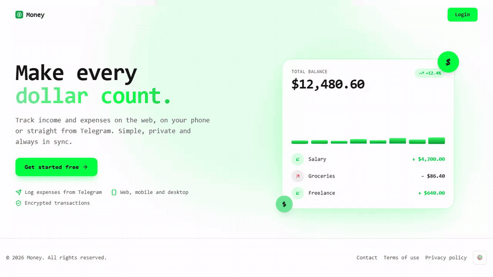
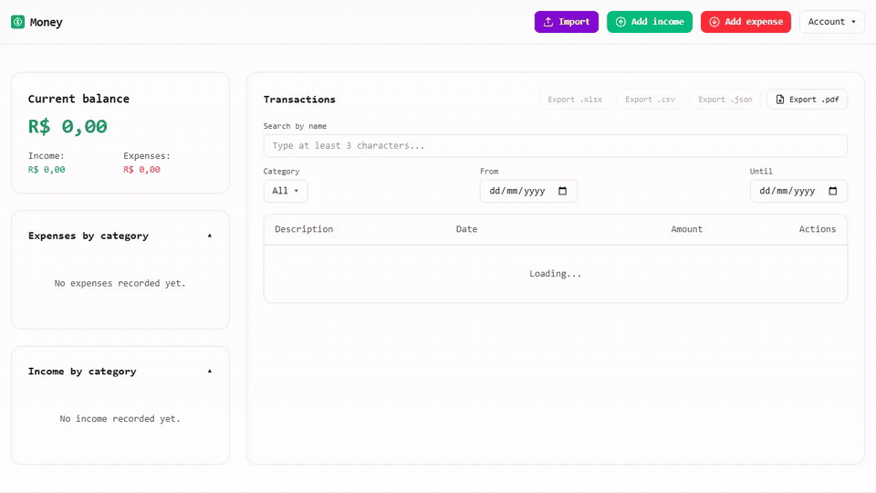
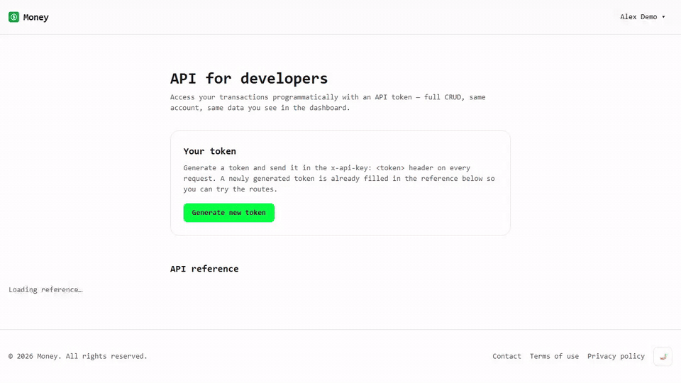

<!-- markdownlint-disable-next-line MD041 -->
<div align="center">


# Agentic Personal Finances

Personal finance monorepo — API, web, Telegram bot, mobile, and desktop —
built for personal use, open-source practice, and agent-assisted development.

[](./LICENSE)
[](https://www.conventionalcommits.org/en/v1.0.0/)
[](https://semver.org/)

</div>

## Stack

| Workspace       | Role                                                                                               |
| --------------- | -------------------------------------------------------------------------------------------------- |
| `packages/core` | Shared hexagonal core (`@agentic-personal-finances/core`)                                          |
| `backend`       | Bun + ElysiaJS API, Prisma, better-auth                                                            |
| `frontend`      | TanStack Start web dashboard                                                                       |
| `bot`           | Telegram bot (grammY)                                                                              |
| `mobile`        | Expo + React Native, **offline-first** (local SQLite, on-device account + fingerprint/face unlock) |
| `desktop`       | Electron app with the API + web + SQLite embedded (works offline)                                  |

SQLite is the default everywhere. PostgreSQL is only used by the hosted
deploy (Railway) and is opt-in locally (`setups/setup-docker.sh postgres`).

## Tour

<!-- Regenerate with `bun scripts/readme-gifs.ts` (see the header of that file). -->

| Landing, sign-up and first look           | Add, search and filter transactions                  |
| ----------------------------------------- | ---------------------------------------------------- |
|  |  |

| API documentation (OpenAPI)                  | Light / dark theme                     |
| -------------------------------------------- | -------------------------------------- |
|  |  |

| JSON backup: export, then import anywhere |
| ----------------------------------------- |
|   |

## Download and try it (no setup)

Every `vX.Y.Z` tag publishes a GitHub Release with ready-made builds:

| File                                         | What it is                                         |
| -------------------------------------------- | -------------------------------------------------- |
| `agent-money-desktop-windows-x64-setup.exe`  | Windows 11 installer — run it, the app opens       |
| `agent-money-desktop-linux-x64.AppImage`     | Linux desktop app                                  |
| `agent-money-desktop-macos-arm64.zip`        | macOS desktop app (ad hoc signed)                  |
| `agent-money-android.apk`                    | Android app — sideload it on your phone            |
| `agent-money-ios-simulator.zip`              | iOS Simulator build (Mac + Xcode)                  |
| `agentic-personal-finances-standalone-*.zip` | API + web + SQLite in one executable, open `:8787` |

Android: open the `.apk` on the phone and allow "install unknown apps" for
the app you used to download it. Windows: SmartScreen may warn because the
installer is unsigned — choose "More info" then "Run anyway".

Data stays on your device in a local SQLite file. Use **Export .json** in
the web/desktop dashboard or **Settings > Export all data** on mobile to
back up everything, and **Import** to restore it on any of them. The mobile
account is local: the backup does not carry it, so after reinstalling you
create a new account and import the backup.

## Quick start (development)

```bash
bun install
cp backend/.env.example backend/.env       # then generate the two secrets inside
bun run --cwd backend db:deploy && bun run --cwd backend db:generate
bun run --cwd backend db:seed              # demo user: admin@gmail.com / adminBR@123
bun run dev:all                            # API :4000, web :4001, Expo, desktop
bun run check                              # lint + typecheck + unit tests
```

Or let a script do the whole bootstrap: `./setups/setup-pm2.sh` (no Docker),
`./setups/setup-docker.sh`, or `./setups/setup-standalone.sh` (one binary).
Use a Git Bash or WSL2 terminal on Windows.

`bun run build` builds the all-in-one executable (frontend + backend +
SQLite) at the repo root; run it with `./agentic-personal-finances` and open
<http://localhost:8787> (loopback only; set `HOST=0.0.0.0` to share it on the LAN). For the PostgreSQL production binary use
`bun run --cwd backend build:postgres`.

## Testing each workspace

Start with `bun install` once at the root. Demo login for the web and bot
flows: `admin@gmail.com` / `adminBR@123` (after `db:seed`).

### Web (`frontend` + `backend`)

```bash
bun run backend:dev && bun run frontend:dev   # or: bun run dev:all
# open http://localhost:4001
bun run backend:test                          # API unit + integration tests
bun run frontend:test                         # web unit tests
bun run qa -- --only web                      # throwaway seeded stack + browser pass
```

Check by hand: landing page, sign up, sign in, add a transaction, **Export
.json**, then **Import** that file again.

### Desktop (`desktop`)

```bash
bun run build                  # embedded server binary (SQLite)
bun run --cwd desktop start    # dev: loads http://localhost:4001 (run the web first)
bun run desktop:dist           # package the installer for your OS in desktop/release/
bun run desktop:smoke          # boots the packaged app and checks that a page rendered
```

The packaged app starts its own server on `localhost` (port 18787, or a free
one) and keeps its database in the per-user app data folder. Set
`DESKTOP_APP_URL=https://your-host` (or pass `--url`) to point it at a remote
server instead.

### Mobile (`mobile`)

The app has no API: transactions are stored in SQLite on the phone. On first
launch you create an account that lives only on the device (name, email,
password hashed with PBKDF2); afterwards the app asks for it again on every
cold start and after 60 s in the background. **Settings > Biometric unlock**
turns on the Android fingerprint / face prompt (with the device PIN or
pattern as fallback). There is no password recovery — export a backup first.

```bash
bun run mobile:dev             # Metro + QR code; open it with Expo Go on the same Wi-Fi
bun run mobile:test            # jest unit tests
bun run typecheck:mobile
./setups/deploy-android-apk.sh --gradle   # build an .apk locally (Android SDK + JDK 17)
./setups/deploy-android-apk.sh            # or build it on Expo's cloud (EAS)
cd mobile && maestro test maestro/        # native E2E on an emulator/device
```

Expo Go is enough for everything except picking a folder for the backup
export on some devices; use the `.apk` for the full flow.

### Telegram bot (`bot`)

1. Create a bot with [@BotFather](https://t.me/BotFather) and copy the token.
2. Copy `bot/.env.example` to `bot/.env`, set `TELEGRAM_BOT_TOKEN`, and copy
   `BETTER_AUTH_SECRET` and `ENCRYPTION_KEY` from `backend/.env` (the bot
   shares the API database and key).
3. Start the API, then the bot:

```bash
bun run backend:dev
bun run bot:dev       # or: ./setups/setup-pm2.sh once bot/.env is filled in
bun run bot:test      # bot unit tests (no Telegram needed)
```

Send `/start` to your bot, sign in with the demo user, then add an expense
and check it on the web dashboard.

## Docs

- [`docs/README.md`](./docs/README.md) — knowledge base index
- [`docs/specs/`](./docs/specs/) — Spec Driven Development (H01–H08, M01–M03)
- [`PLAN.md`](./PLAN.md) — roadmap / session checklist
- [`CONTRIBUTING.md`](./CONTRIBUTING.md) — branches, commits, PRs
- [`.agents/skills/`](./.agents/skills/) — agent skills (see `SOURCES.md`)

## License

[MIT](./LICENSE) © Alex Galhardo
